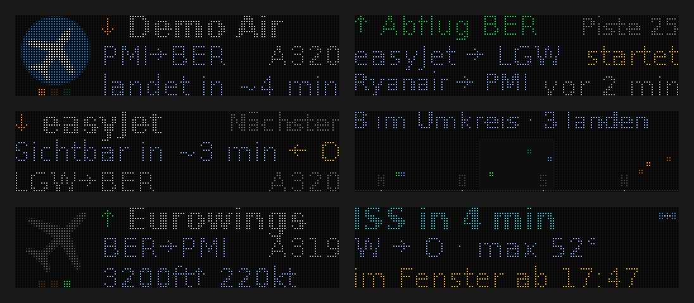
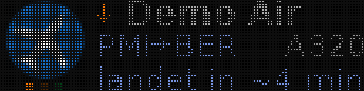
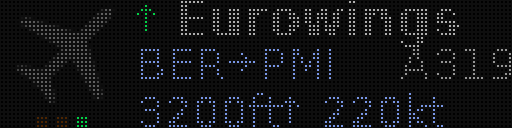
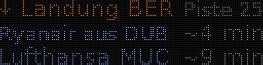
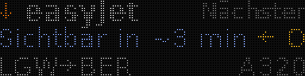
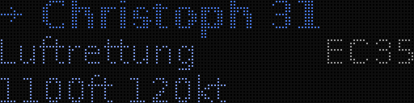
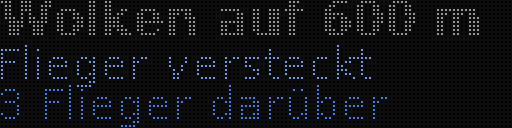
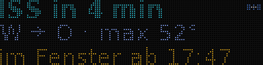
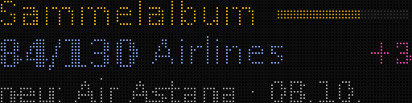

# flightpanel

**Ein LED-Panel fürs Fenster, das zeigt, welches Flugzeug man gerade draußen sieht:** Airline-Logo, Route, Typ, Höhe und Minuten bis zur Landung. Ist keins zu sehen, wechseln Karten mit Abflügen und Landungen am Flughafen, dem nächsten Flieger, Radar, Wetter, ISS und ein paar Spielereien.

*An LED panel for the window that shows which plane you are looking at. Documentation in German.*

> [!WARNING]
> **Ein komplett vibe-codetes Wochenendprojekt.** Jede Zeile Code und Doku hier hat eine KI geschrieben (Claude). Keine Wartungszusage, keine Garantie. Nachbauen, Abschauen und Weitermachen ausdrücklich erwünscht, auf eigene Gefahr.
>
> *Fully vibe-coded weekend project: every line of code and documentation was written by an AI (Claude). No support, no warranty. Rebuilding, borrowing and building on it is explicitly welcome, at your own risk.*



Zwei HUB75-Panels P2.5 (64 × 32) nebeneinander ergeben 128 × 32 Pixel auf 32 × 8 cm. Ein ESP32 steuert sie an, ein kleiner Server (Docker, etwa im Homelab) macht den Rest. Teile, Verdrahtung und Zusammenbau: [docs/bauanleitung.md](docs/bauanleitung.md). Alle Bildschirme mit Bildern und Rangfolge: [docs/screens.md](docs/screens.md).

## Stand

- **Läuft:** der Server mit echten Daten im Docker-Container, am Fenster gegen den Himmel und Flightradar24 geprüft. Landefolge, Minuten bis zur Landung und Sichtfeld stimmen dort gut.
- **Ungetestet:** die Firmware auf echter Hardware (sie kompiliert) und ein Dauerbetrieb über Wochen.
- **Ortsgebunden:** entwickelt in Berlin für den Flughafen BER. Alles Ortsabhängige ist einstellbar; die Spaß-Inhalte (`data/jokes.json`) und zwei Karten gibt es nur für den BER.

## So funktioniert es

```
adsb.lol (Ersatz: OpenSky) ─┐
adsb.im, adsbdb (Routen) ───┤
OpenSky-Flugspur (Herkunft) ┼─> Server (Python, Docker) ──HTTP /frame──> ESP32 ──HUB75──> 2 Panels
METAR, Celestrak (ISS) ─────┤   ruft alle 20 s ab, rendert    12 KB alle 2 s     DMA-Refresh
Logo-CDNs ──────────────────┘   bei jedem Abruf ein Bild
```

Der Server rendert das komplette Bild. Der ESP32 holt es nur ab und schreibt es in die Panels; er kennt weder Flüge noch Schriften noch Logos. Jede Änderung am Aussehen passiert in Python, mit Vorschau im Browser und ohne Flashen.

## Schnellstart (ohne Hardware, ohne Netz)

```bash
cp .env.example .env            # MOCK=1 ist schon gesetzt: Fantasieflüge
docker compose up -d --build
open http://localhost:8080      # Vorschau, wechselt alle 2 s
```

Die Vorschauseite hat Links für die Layouts und jede Leerlauf-Karte; `/frame.png?card=radar&scale=8` geht auch direkt.

## Einrichten

Alles Ortsabhängige steht in `.env` (nicht im Repo; jede Einstellung ist in [.env.example](.env.example) erklärt). Für echte Daten: `MOCK=0`, dann vier Dinge.

**1. Standort.** `HOME_LAT`, `HOME_LON` (Dezimalgrad), `HOME_ALT_M` (Augenhöhe am Fenster über dem Meer). Angezeigt wird, was höchstens `RADIUS_KM` weit weg und `MAX_ALT_M` hoch ist.

**2. Sichtfeld.** Was man vom Fenster aus sieht: Richtung im Uhrzeigersinn von `VIEW_FROM` bis `VIEW_TO` (0 = Nord, 90 = Ost), Mindesthöhe über dem Horizont `VIEW_MIN_ELEV` (Häuser, Bäume), Obergrenze `VIEW_MAX_ELEV` (Balkon darüber), Sichtweite `VIEW_MAX_KM`. `VIEW_ONLY=1` zeigt nur, was im Sichtfeld ist. Eichen: am Fenster ein Flugzeug suchen und in `/display.json` → `nearby` dessen Richtung (`az`) und Höhenwinkel (`elev`) ablesen.

**3. Heimatflughafen.** `LOCAL_AIRPORT_IATA` genügt: Position, Höhe und METAR-Station kommen aus `data/airports.json`. Dazu `RUNWAY_COURSE`, der Kurs im Endanflug einer Landerichtung (BER 25: 249°, MUC 26: 263°), und `CURFEW_HOURS` für das Nachtflugverbot. Für einen Flughafen, der nicht in der Liste steht, `AIRPORT_LAT`, `AIRPORT_LON`, `AIRPORT_ALT_M` und `METAR_STATION` setzen.

**4. Karten und Ruhe.** Jede Leerlauf-Karte lässt sich abschalten: `CARD_<ID>=0`, z. B. `CARD_JOKE=0`. `CALM=1` ist der ruhige Modus: nichts blinkt außer einem Notfall, Infoseiten wechseln alle 10 s statt 4 s, unten stehen nur Landezeit und Höhe/Tempo. Jede dieser Einzelheiten ist auch einzeln einstellbar (`PAGE_SECONDS`, `FLIGHT_SECONDS`, `INFO_PAGES`, `BLINK`, `IDLE_SECONDS`).

Dann `docker compose up -d --build` und einmal die Logos holen: `docker compose exec flightpanel python3 -m flightpanel.fetch_logos`. Unsinnige Werte (`PAGE_SECONDS=0`, `POLL_INTERVAL=oft`) brechen den Start mit dem Namen der Variablen ab; Verdächtiges, etwa Koordinaten, die nicht zum Flughafen passen, steht als Warnung im Log. Falsch geschriebene Namen fallen nicht auf: Die Werte unter `/health` zeigen, was wirklich gilt.

## Was angezeigt wird

Bei jedem Abruf ordnet der Server alle Flugzeuge im Radius:

1. **Sichtfeld zuerst.** Zählt auch, wer bis zum nächsten Abruf hineinfliegt (aus Tempo, Kurs und Steigrate weitergerechnet), sonst wären Anflüge schon durch, bevor sie auf dem Panel stehen.
2. **Airlines vor dem Rest.** Linien-, Charter- und Frachtflüge zählen als Airline. Privatflieger, Hubschrauber, Polizei und Militär (`"airline": false` in `data/airlines.json`) kommen nur dran, wenn keine Airline zu sehen ist, dann als Leerlauf-Karte; `SHOW_OTHER=0` blendet sie aus.
3. **Landefolge, dann kürzeste Sichtlinie.** Wer als nächstes landet, kommt zuerst. Die Landefolge schätzt der Server aus der Reststrecke bis zur Piste: im Endanflug die Entfernung, im Gegenanflug weiter bis zum Eindrehen und den ganzen Endanflug zurück, im Queranflug quer zur Achse plus Rest. Die Landerichtung erkennt er am Verkehr in Platznähe.

Bis zu `MAX_FLIGHTS` Flüge wechseln sich ab, jeder mit allen Infoseiten, mindestens `FLIGHT_SECONDS`.



**Layouts** (`LAYOUT`): **C** mit Logo links (32 × 32), rechts drei Zeilen; **A** ohne Logo über die ganze Breite; **B** zwei Flüge, je eine Zeile. Hat eine Airline kein Logo, steht in C ein graues Flugzeug an seiner Stelle, damit Text und Himmelspunkte im Wechsel mit Flügen mit Logo stehen bleiben. Privatflieger und Hubschrauber ohne Logo nutzen die ganze Breite wie in A. Zeile 1: Pfeil (↓ Landung, ↑ Start, → Überflug) und Airline. Zeile 2: Route, sonst was der Flug ist (Luftrettung, Polizei, Kleinflugzeug: aus `airlines.json`, ADS-B-Kategorie oder Kennzeichen), sonst `?→BER` oder `BER→?`; rechts der Typ. Zeile 3 wechselt (`INFO_PAGES`): "landet in ~7 min", Höhe und Tempo, Entfernung und Kurs, Rufzeichen. Farben: Landung amber, Start grün, Überflug blau, kein Weiß.



**Himmelspunkte:** Sind mindestens zwei gezeigte Flugzeuge im Sichtfeld, steht unter dem (dann 28 × 28 kleinen) Logo eine Punktreihe, ein Punkt pro Flug in Lesereihenfolge: links der, der zuerst landet. Der Punkt des gezeigten Flugs leuchtet.

**Grundsätze:** Nichts steht doppelt (das Rufzeichen fällt aus dem Wechsel, wenn es oben schon steht). Text wird nie so gekürzt, dass sich der Sinn ändert: erst kleinere Schrift, dann eine kürzere Fassung. Alle Pixel werden genutzt; Text am Rand sitzt auf der ersten oder letzten Spalte. Privatflieger heißen nach ihrem Kennzeichen (D-EHGB), Rettungshubschrauber nach ihrer Nummer (Christoph 31); Halternamen kommen nie aufs Panel. Lieber ein ehrliches `?` als eine falsche Herkunft.

**Leerlauf:** Ohne Airline im Sichtfeld wechseln Karten alle `IDLE_SECONDS` in festen Stufen: Verkehr am Platz (Abflüge, Landungen, nächster Flieger, Privatflieger) vor Informationen (Radar, Landerichtung, Wetter, Statistik, ISS, Sonne) vor Spielereien, die nur kommen, wenn am Flughafen seit 15 min nichts los war. Ein Notfall-Squawk (7700, 7600, 7500) geht allem vor. Gezeichnet wird nur die Karte, die gerade dran ist, bei jedem Abruf des ESP32 neu.

| | |
|---|---|
|  |  |
|  |  |
|  |  |

Alle Karten mit Bild, Stufe und Bedingung: [docs/screens.md](docs/screens.md).

## Datenquellen

| Was | Quelle | Bemerkung |
|---|---|---|
| Flugzeuge | [adsb.lol](https://adsb.lol) (`SOURCE=adsblol`) | Community-Netz aus ADS-B-Empfängern, ohne Account, alle `POLL_INTERVAL` Sekunden. Liefert auch Typ und ADS-B-Kategorie (Hubschrauber, Leichtflugzeug). Daten unter ODbL. |
| Ersatz | [OpenSky](https://opensky-network.org) | springt ein, wenn adsb.lol ausfällt, so oft das Tagesbudget erlaubt (anonym 400 Credits, mit Account 4000: `OPENSKY_CLIENT_ID`/`_SECRET`). `SOURCE=opensky` nimmt nur OpenSky. |
| Routen | [adsb.im](https://adsb.im), dann [adsbdb](https://www.adsbdb.com) | pro Callsign gespeichert und oft alt; liegt das Flugzeug weit neben der Strecke, verwirft der Server sie. Fliegt eine Airline hin und zurück unter einem Callsign (BER-NCE-BER), zählt die Teilstrecke, auf der das Flugzeug gerade ist. |
| Herkunft ohne Route | OpenSky-Flugspur | beginnt die Spur am Boden, ist der nächste Flughafen aus `data/airports.json` der Start; beginnt sie erst in der Luft, bleibt die Herkunft offen. |
| Wetter | aviationweather.gov, NOAA | METAR alle 20 min (`METAR=0` schaltet ab). |
| ISS | [Celestrak](https://celestrak.org) | Bahndaten einmal am Tag, Überflüge rechnet der Server (`ISS=0`). |
| Logos | Kiwi.com, FlightAware, Google | holt der Server beim ersten Auftauchen einer Airline; nicht im Repo. |
| Flughäfen | [OurAirports](https://ourairports.com) | gemeinfrei, `tools/make_airports.py` erzeugt `data/airports.json`. |

Fällt eine Quelle aus, fehlen nur ihre Teile: ohne Routen keine Herkunft, ohne METAR keine Wetterkarten. Ohne frische Flugdaten wird das Bild nach 2 min gedimmt und nach 10 min leer (`STALE_AFTER`, `EMPTY_AFTER`). Fehler stehen in `/issues` und `/health`.

## Airline-Logos

Nur quadratische Bildmarken: Schriftzüge sind bei 32 × 32 Pixeln unlesbar, dann steht dort der Platzhalter (graues Flugzeug). Der Server probiert die Quellen der Reihe nach, nimmt das erste Bild mit Seitenverhältnis bis `LOGO_MAX_ASPECT`, entfernt weißen Hintergrund, schneidet zu und legt `data/logos/<IATA>.png` ab (ohne IATA-Code `<ICAO>.png`). Platzhalterbilder der Quellen erkennt er. Fehlschläge stehen in `/health` → `logos_missing` und werden nach 7 Tagen erneut probiert.

- Alle auf einmal: `python3 -m flightpanel.fetch_logos` (im Container: `docker compose exec flightpanel …`), gezielt `… fetch_logos LH U2 FR`, `--force` holt abgerufene neu.
- Eigene Logos, wenn keins gefunden wird oder das abgerufene nicht gefällt (App-Icons, bei denen die Marke auf einer Kachel klein wird): `tools/make_logo.py bild.png U2` macht aus PNG, JPG, WebP oder SVG das passende Format und legt es in `data/logos/own/` ab, mit Vorschau in `own/preview/`; die Originale passen nach `own/src/`, dort sucht der Server nicht. Ohne Python auf dem Rechner: `docker compose run --rm -v "$PWD:/repo" -w /repo flightpanel python tools/make_logo.py bild.png U2`. Weißer Hintergrund fällt weg; `--mark "#ff6600"` nimmt von einer farbigen Kachel nur die weiße Marke, in dieser Farbe (das e von easyJet). Eigene gehen den abgerufenen vor, der Abruf fasst sie nie an, auch nicht mit `--force`; löschen, um zum abgerufenen zurückzukehren. Code ist der Logo-Code aus `airlines.json`, eine Datei gilt also für alle Betriebe einer Marke.
- Logos bleiben lokal (sie sind Marken der Airlines und gehören nicht ins Repo). Beim Umzug auf einen anderen Rechner `data/logos/own/` mitnehmen, den Rest holt der Server neu.
- `data/airlines.json` bildet ICAO-Codes auf kurze Namen und den Logo-Code ab: die Marke, nicht unbedingt der Tochterbetrieb (Malta Air → `FR`, KLM Cityhopper → `KL`). So bekommt ein Tochterbetrieb ohne eigenes quadratisches Logo das der Marke. Leer heißt Logo per ICAO, wenn der IATA-Code doppelt vergeben ist.

## Endpunkte

| Pfad | Zweck |
|---|---|
| `/` | Vorschauseite |
| `/frame` | Binär für den ESP32: `[1, Helligkeit, 128, 32]` + 12 288 Byte RGB |
| `/frame.png` | Vorschau; `layout`, `card`, `scale`, `gap=0` |
| `/display.json` | Display-Modell, dazu `nearby`: alle Flugzeuge im Radius mit Richtung, Höhenwinkel, Sichtbarkeit, Landefolge |
| `/health` | Quellen, wirksame Anzeige-Einstellungen, Cache, Logos, letzter ESP32-Abruf (`esp32.alive=false`: Panel hängt) |
| `/issues` | gesammelte Auffälligkeiten (siehe unten), `POST /issues/clear` leert |
| `/stats` | Tagesstatistik, Sammelalbum, seltene Sichtungen, Landerichtung |
| `/idle` | Leerlauf-Karten: Stufe, ob sie gerade etwas zu sagen haben, welche dran ist |

## Betrieb auf dem Server

```bash
git clone https://github.com/toastbrot2000/flightpanel && cd flightpanel
cp /pfad/zur/alten/.env .env
docker compose up -d --build
docker compose exec flightpanel python3 -m flightpanel.fetch_logos
```

Dann `/health` ansehen: `source.active` sollte `adsblol` sein. Updates: `git pull && docker compose up -d --build`. Cache, Logos, Statistik und Auffälligkeiten liegen in `data/` und bleiben. In den `QUIET_HOURS` ist das Panel schwarz und der Server ruft nichts ab.

**Ältere `.env`:** `IDLE_OFF` heißt jetzt `CARD_<ID>=0` je Karte, `LOGO_URL` heißt `LOGO_URLS`. `LAYOUT=auto` ist jetzt dasselbe wie `C`. Ausdrücklich gesetzte Werte gehen dem ruhigen Modus vor: Mit `CALM=1` die alte Zeile `PAGE_SECONDS=4` löschen. `AIRPORT_LAT`, `AIRPORT_LON`, `METAR_STATION` nur noch setzen, wenn der Flughafen nicht in `data/airports.json` steht. Der Server sagt beim Start im Log, was davon er gefunden hat.

**Auffälligkeiten (`/issues`)** sammelt der Server im Betrieb, mit Zähler, erstem und letztem Auftreten, Callsigns und einem Beispiel:

| Art | Bedeutung | Was tun |
|---|---|---|
| `unknown_operator` | Betreibercode nicht in `airlines.json` | eintragen (Name, Logo-Code), `"airline": false` für Rettung, Polizei, Militär |
| `name_mismatch` | unser Name passt nicht zu adsbdb | meist alte Daten bei adsbdb (Sundair heißt dort City Airline): geprüft mit `"adsbdb": "Name dort"` eintragen, dann kommt er nicht wieder; sonst Fehler bei uns |
| `route_implausible` | Route passt nicht zur Position, verworfen | nichts, zur Kontrolle |
| `route_unknown` | gezeigter Airline-Flug ohne Route | nichts, keine Quelle kennt ihn |
| `source_error`, `rate_limit`, `fallback` | Fehler, HTTP 429, OpenSky eingesprungen | bei Häufung `POLL_INTERVAL` erhöhen |
| `stale` | Bild gedimmt oder leer mangels Daten | Quellen prüfen |
| `esp32_gap` | ESP32 hat länger keinen Frame geholt | WLAN, Stromversorgung |
| `exception` | Fehler im Code, mit Datei und Zeile | Bug, Traceback im Container-Log |

Liegt in `data/issues.json`. Nach dem Durchsehen leeren: `curl -X POST http://server:8080/issues/clear`.

**Dauerbetrieb:** Der Server ist darauf ausgelegt, monatelang ohne Neustart zu laufen. Einmal pro Nacht, zu Beginn der `QUIET_HOURS` (ohne Ruhezeit um 4 Uhr), räumt er auf: `/issues` vergisst Einmaliges (nur an einem Tag gesehen) nach 7 Tagen und alles andere, wenn es 30 Tage nicht mehr aufgetreten ist; Fehler im Code bleiben mindestens 30 Tage. Ist `/issues` trotzdem voll (1000 Einträge), macht der älteste Platz. Der Cache wirft Abgelaufenes bei jedem Speichern weg. Was die letzte Nacht getan hat, steht in `/health` unter `dream`. Das Docker-Log ist auf 15 MB begrenzt (`compose.yml`). Einmal im Monat das Image neu bauen, damit Sicherheitsupdates und neue Zertifikate des Basis-Images ankommen: `docker compose build --pull && docker compose up -d`.

## Hardware und Firmware

PlatformIO, Board `esp32dev` (klassischer ESP32, WROOM-32), Bibliothek ESP32-HUB75-MatrixPanel-DMA 3.0.14. Der ESP32 holt alle 2 s `/frame` und zeigt es an; ohne Server bleibt das letzte Bild stehen, nach 60 s mit einem roten Punkt unten rechts, nach 10 min startet er neu.

```bash
cd firmware
cp include/secrets.h.example include/secrets.h   # WLAN (2,4 GHz!), Server-URL, OTA-Passwort
pio run -t upload                                # erstes Mal per USB, danach: pio run -e esp32dev_ota -t upload
```

Teile, Strom, Verdrahtung (Pinbelegung), Testbild und Stellschrauben stehen in der [Bauanleitung](docs/bauanleitung.md). Kompilieren ohne lokales PlatformIO: `sh tools/check_firmware.sh` (Docker).

## Entwicklung

```bash
pip install -r server/requirements-dev.txt    # dazu DejaVu-Schriften (fonts-dejavu-core), wie im Container
pytest                                        # vom Repo-Wurzelverzeichnis, ohne Netz
ruff check .
MOCK=1 DATA_DIR=./data PYTHONPATH=server python3 -m flightpanel.main
```

Die Tests prüfen ohne Netz: Einstellungen, Sichtfeld und Vorhersage, Landefolge, Routen (auch hin und zurück unter einem Callsign), Kartenauswahl, Statistik, METAR, Sonne (gegen veröffentlichte Zeiten), ISS (gegen eine unabhängige Position), jede Karte mit Beispieldaten und jeden HTTP-Endpunkt. GitHub Actions baut bei jedem Push den Container und führt darin Lint und Tests aus; bei Änderungen an `firmware/` kompiliert es die Firmware. Die Bilder in dieser Doku erzeugt `tools/screenshots.py` aus Beispieldaten; nach Änderungen am Aussehen neu erzeugen.

### Aufbau

```
server/flightpanel/
  main.py        Einstieg: App, Abruf-, Wetter-, ISS- und Speicherschleife
  web.py         HTTP-Endpunkte und Vorschauseite
  config.py      Einstellungen aus .env (Config.from_env), ruhiger Modus, Helligkeit
  data.py        mitgelieferte Daten laden; storage.py Dateien atomar schreiben
  issues.py      Auffälligkeiten sammeln (/issues); cache.py Antworten mit Ablaufzeit

  Quellen        adsblol.py, opensky.py (Flugzeuge), adsbim.py, adsbdb.py (Routen),
                 origins.py (Herkunft aus der Flugspur), metar.py (Wetter), astro.py (Sonne, ISS),
                 logos.py, logo_image.py, fetch_logos.py (Logos)
  model.py       State (ein Flugzeug von der Quelle), Flight (fürs Panel), DisplayModel
  build.py       baut bei jedem Abruf das DisplayModel
  airlines.py    Betreiber, Airline oder nicht, Routenprüfung
  aircraft.py    Kennzeichen, Flugzeugklasse, Text für Zeile 2
  view.py        Sichtfeld: Richtung, Höhenwinkel, wann einer hineinfliegt
  airport.py     Landerichtung, Landefolge und -zeit, Abflüge, wer zuletzt landete oder startete
  stats.py       Tagesstatistik, Sammelalbum, seltene Flugzeuge, Flaute
  mock.py        Fantasieflüge für MOCK=1

  render.py      Fluglayouts, Himmelspunkte, Frame-Bytes und PNG
  draw.py        Zeilenraster und Texthelfer; fonts.py, colors.py, sprites.py
  idle.py        Auswahl der Leerlauf-Karten (Stufen, Gewichte, Dringendes)
  cards/         die Karten: traffic, runway, album, sky, fun; Liste in __init__.py
server/tests/    pytest
firmware/        ESP32: platformio.ini, src/main.cpp, include/config.h, secrets.h.example
tools/           make_logo.py, make_airports.py, screenshots.py, check_firmware.sh
data/            airlines.json, airports.json, rare.json, jokes.json;
                 im Betrieb logos/, cache.json, issues.json, stats.json, tle.txt
docs/            bauanleitung.md (Hardware), screens.md (alle Bildschirme), images/
```

### Eine Leerlauf-Karte hinzufügen

1. In der passenden Datei unter `server/flightpanel/cards/` zwei Funktionen: `foo_cond(ctx)` gibt `Hit(daten)` zurück oder `None`, wenn die Karte gerade nichts zu sagen hat; `foo_draw(img, ctx, daten, t_in, f)` zeichnet. Optional `foo_demo(ctx)` mit Beispieldaten. Was `ctx` mitbringt: `idle.Ctx`; Texthelfer: `draw.py`.
2. Eintrag in `CARDS` in `cards/__init__.py`, mit Stufe (`tier`) und Gewicht.
3. Ansehen: `/frame.png?card=foo`. Der Test `test_every_card_renders_with_demo_data` zeichnet sie automatisch mit.
4. `CARD_FOO=1` in `.env.example` und eine Zeile in `docs/screens.md`.

### Eine Airline nachtragen

In `data/airlines.json`: `"ICAO": {"name": "Kurzname", "iata": "XY"}`. Für Rettung, Polizei, Militär `"airline": false` und `"label": "Polizei"`; mit `"number": true` wird aus CHX31 "Christoph 31". Danach das Logo holen (`fetch_logos XY`) oder von Hand machen (`tools/make_logo.py`). Kandidaten sammelt `/issues` unter `unknown_operator`. Der Name steht neben dem Logo in 94 px; ist er zu lang, eine kurze Fassung wählen ("CPH AirTaxi" statt "Copenhagen Airtaxi").

## Lizenz und Rechte

Code und Doku stehen unter der [MIT-Lizenz](LICENSE). Flugdaten von adsb.lol stehen unter ODbL, `data/airports.json` stammt von OurAirports (gemeinfrei). Airline-Namen und -Logos sind Marken ihrer Inhaber; Logos sind nicht Teil des Repos, der Server lädt sie für den privaten Gebrauch. "Demo Air" in den Beispielbildern ist erfunden.
