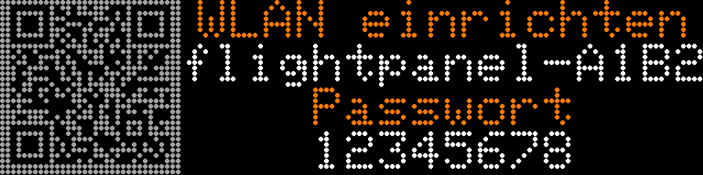

# Building the hardware

How to build the panel: parts, mounting, power, wiring, firmware and first start. The server and its settings are covered in [configuration.md](configuration.md), the screens in [screens.md](screens.md).

> **Status:** one panel has been built along this guide and runs: flashing over USB, setup from a phone, frames over the LAN. Signed updates, rollback and rescue mode are tested on the computer but not yet on hardware. If you build one and find something missing or different, feedback is welcome.

**Result:** a 32 × 8 cm display with 128 × 32 pixels from two HUB75 panels, an ESP32 behind it, powered by a 5 V desktop power supply. No soldering and no mains wiring: the only part that touches 230 V is a closed, certified power supply.

**Effort:** one evening for power, cables and the first image, an afternoon for the mounting board. Material roughly 100 to 120 € (2026 prices).

**In a hurry:** buy the parts in section 1, then follow [section 5](#5-step-by-step-assembly); the other sections are reference.

## Contents

1. [Parts](#1-parts)
2. [Mounting](#2-mounting)
3. [Power and wiring](#3-power-and-wiring)
4. [Firmware](#4-firmware)
5. [Step-by-step assembly](#5-step-by-step-assembly)
6. [Test pattern and bench tests](#6-test-pattern-and-bench-tests)
7. [Signed firmware updates](#7-signed-firmware-updates)
8. [Experimental: Arduino-ESP32 3.x build](#8-experimental-arduino-esp32-3x-build)
9. [Troubleshooting](#9-troubleshooting)

---

## 1. Parts

| Part | Qty | Purpose | Notes |
|---|---|---|---|
| HUB75 panel P2.5, 64 × 32 pixels, 1/16 scan, 160 × 80 mm | 2 | display, 128 × 32 pixels together | Designed around the Waveshare RGB-Matrix-P2.5-64x32 (magnets and M3 threads on the back, ribbon and power cables included). Other panels work if size and scan rate match; otherwise adjust `firmware/include/config.h`. |
| ESP32, classic (WROOM-32, e.g. a NodeMCU-style board) | 1 | fetches frames, drives the panels | Not an ESP32-C3 or -S3: the HUB75 library uses the parallel I2S DMA of the classic ESP32, where it is most mature. |
| 5 V desktop power supply, at least 4 A, 5.5 mm barrel plug with screw-terminal adapter | 1 | power for panels and ESP32 | Closed and certified (CE). More amps do no harm; actual draw stays below 3 A (see 3.2). |
| Dupont jumper wires, male, 10 to 20 cm | 14 | ESP32 → ribbon cable of the first panel | keep them short |
| Wago 221 lever connectors (3-way) or a terminal block | 3 | 5 V distribution: supply → 2 panels and ESP32 | |
| Mounting board 340 × 100 mm: 6 mm plywood or steel sheet | 1 | mounting | On steel the panels hold by their magnets; on wood use 8 × M3 × 8 screws. |
| M3 standoffs or adhesive pads, cable ties, velcro | | ESP32 and cables on the back | |

**Tools:** multimeter (to check polarity and voltage), a drill for the board, and a computer with [PlatformIO](https://platformio.org) to flash over USB (Docker alone can check the build but not flash it).

**Optional:**

| Part | When |
|---|---|
| Frame and front of **tinted** acrylic, 3 mm, smoke grey (30 to 50 % transmission), 2 to 4 mm in front of the LEDs | once you like the bare panel. Tinted, not opal: the tint makes unlit LEDs look like a black surface and reduces reflections; opal acrylic would blur the 2.5 mm pixels. |
| 2 × 74HCT245 | only if the image is unstable with 3.3 V logic (see 3.4) |

Why HUB75 P2.5: it has 16 times the pixel density of WS2812 panels, so a logo and three lines of text fit at once, and the modules come ready-made. 128 × 32 is exactly what the layout needs; a 128 × 64 setup costs twice as much and the server layouts assume 32 pixels height.

---

## 2. Mounting

**Dimensions:** two panels side by side, 320 × 80 mm active area, about 15 mm deep plus the ESP32 behind. Mounting board 340 × 100 mm, i.e. a 1 cm border. Weight below 500 g.

**Mounting the panels:**

1. Place the panels so that the ribbon connectors of both are on the same side and the connector marked **IN** (or "DATA IN", arrow pointing inwards) of the left panel faces the ESP32. Each panel has IN and OUT; the arrows on the back show the data direction.
2. Butt the panels directly against each other. Waveshare panels are milled to 160 mm, the seam is practically invisible at 2.5 mm pitch.
3. On steel: put them on, the magnets hold. On wood: screw through the board into the M3 threads on the back of the panels (measure the hole spacing on your panel, drill 3.2 mm).

**Back side:** ESP32 centred behind the left panel, Dupont wires under 20 cm to the HUB75 input. Fix connectors and the power cable with velcro or cable ties. The power supply does not go on the panel; it sits behind the furniture or hangs on its cable.

**Hanging:** two screws, keyhole plates or two hooks. Or stand it on a shelf; two wooden blocks make a stand.

---

## 3. Power and wiring

### 3.1 Power supply

Run two wires from the screw-terminal adapter of the power supply to the lever connectors (+ and −). No cutting, no soldering.

Each panel has a 4-pin power connector (VH3.96, 2 × VCC, 2 × GND) and comes with a matching cable. Connect both panel cables in parallel to the connectors. **Check polarity:** VCC/GND is printed next to the connector on the panel, red goes to VCC. Reversed polarity destroys the drivers.

ESP32: VIN to +5 V, GND to GND, on the same connectors. Without a common ground between ESP32 and panels no data line works. A fuse on the 5 V side is not needed: the power supply has over-current and over-temperature protection and the load is far below its limit.

### 3.2 Current draw

Waveshare specifies 5 V / 2.5 A, at most 12 W per panel (all white, full brightness). That never happens here: no white text, 10 to 20 % of pixels lit, and brightness capped (`MAX_BRIGHTNESS 160` in the firmware; the server sends 90 during the day). Expect 0.3 to 1 A for both panels plus 0.15 A for the ESP32. A 5 V / 4 A supply is enough; a bigger one runs cooler.

### 3.3 Data cable ESP32 → HUB75

The ESP32 drives the panels directly over 13 signal lines plus ground. Panel 1 OUT → panel 2 IN with the included ribbon cable.

**Simplest connection:** plug the second included ribbon cable into panel 1 IN. Male Dupont pins fit directly into the free connector at the other end (2.54 mm pitch). That is mechanically cleaner than female Dupont plugs on the panel's pin header.

HUB75 pinout, looking at the socket at the cable end, key (polarisation notch) on the left:

```
 R1 | G1
 B1 | GND
 R2 | G2
 B2 | E        E is unused with 1/16 scan (64x32): leave open or GND
 A  | B
 C  | D
CLK | LAT
 OE | GND
```

ESP32 pins (library default, in `firmware/include/config.h`):

| HUB75 | ESP32 GPIO | HUB75 | ESP32 GPIO |
|---|---|---|---|
| R1 | 25 | A | 23 |
| G1 | 26 | B | 19 |
| B1 | 27 | C | 5 |
| R2 | 14 | D | 17 |
| G2 | 12 | E | not connected |
| B2 | 13 | LAT | 4 |
| CLK | 16 | OE | 15 |
| GND | GND (connect both GND pins) | | |

That makes 14 wires. Labelled wires or a photo help; swapped colour lines show up immediately in the test pattern (red becomes green), swapped address lines give scrambled rows. GPIO 12 and 15 are ESP32 strapping pins; that is the library default and works because the panel inputs are high-impedance.

### 3.4 Logic levels: 3.3 V is usually enough

HUB75 panels buffer their inputs with 74HC245 chips at 5 V. Their threshold is around 2.5 V, so the ESP32's 3.3 V is recognised reliably with short wires. Waveshare's documentation for this panel shows ESP32 and Raspberry Pi (both 3.3 V logic) connected directly, with the same library.

If you still get flicker, ghosting or colour noise that `HUB75_CLKPHASE` and `HUB75_LATCH_BLANKING` (section 4.6) don't fix: put two 74HCT245 (8 channels each, 5 V supply, direction A→B) between ESP32 and panel. With 4-channel buffers such as the 74AHCT125, two chips cover the 8 most critical lines (CLK, LAT, OE, A to D, R1).

### 3.5 USB and VIN

Never power the ESP32 over USB and VIN at the same time. To flash over USB, unplug the VIN wire; the panels may keep running from the power supply, GND stays connected. After the first flash, updates can go over Wi-Fi (OTA) once an OTA password is set (section 4.4).

---

## 4. Firmware

PlatformIO, board `esp32dev`, Arduino framework (Arduino-ESP32 2.0.17), ESP32-HUB75-MatrixPanel-DMA 3.0.14, Adafruit GFX (test pattern and text on the panel), ArduinoOTA. Wi-Fi, server address and access token are not compiled in; they live in the panel's flash (NVS) and are entered from a phone through the panel's setup Wi-Fi. Without a `secrets.h` (section 4.3) one build fits every panel.

### 4.1 Build and flash

Flashing needs a local PlatformIO. All versions are pinned: platform and libraries in `platformio.ini` (the HUB75 library by commit), PlatformIO itself in `firmware/platformio.lock`. To install exactly that version, in the repository root:

```bash
python3 -m venv .venv
.venv/bin/pip install --require-hashes -r firmware/platformio.lock    # Windows: .venv\Scripts\pip
. .venv/bin/activate                                                  # Windows: .venv\Scripts\activate
```

Then build, flash and watch the console:

```bash
cd firmware
pio run -t upload      # over USB, with VIN unplugged
pio device monitor     # serial console, 115200 baud
```

The VS Code extension works too, but installs its own, unpinned PlatformIO. `sh tools/check_firmware.sh` checks in Docker that the firmware builds and passes its tests ([development.md](development.md#firmware-checks)); it keeps no image, so it can't replace PlatformIO for flashing.

**Partition table:** `min_spiffs.csv`, two app slots of 1.875 MB each, needed for HTTPS, the setup portal and updates. A partition table only reaches the panel over USB, never over OTA or a signed update.

### 4.2 Setup portal (first start)

A panel that has not been set up opens its own Wi-Fi access point `flightpanel-XXXX` after start-up. While it is open, the LED panel shows the access point name, its password (8 digits, new every time the portal opens) and a QR code. Scan the QR code with the phone camera, or join `flightpanel-XXXX` manually with the password shown. The setup page opens by itself (otherwise go to `http://192.168.4.1`).



1. Choose your Wi-Fi (2.4 GHz only; the ESP32 has no 5 GHz) and enter its password.
2. Under **Erweitert** (Advanced) enter the server address: on your home network `http://<server>:8080`, e.g. `http://192.168.1.20:8080`; for a panel elsewhere, reached over Cloudflare, `https://<hostname>` plus the Client ID and Client Secret of its service token ([remote-panels.md](remote-panels.md)).
3. **Speichern und neu starten** (Save and restart). Done.

The portal pages and the panel's own texts are in German.

Details worth knowing:

- The secret is never shown again, it can only be overwritten. Changing the server address deletes the stored token. A token only works with an `https://` address.
- You can enter server and token in advance and leave Wi-Fi empty, e.g. before giving the panel away. Until a Wi-Fi is stored, the full portal opens at every power-on without time limit and shows its password on the LEDs; whoever reads it can change server and token or reset everything (they never see the secret). Hand the panel over soon after setting it up.
- Use an IP address for the server if you can. A name without a dot only works if your router resolves it. A name with a dot that is not `*.local`, `*.home.arpa` or `*.internal` (e.g. `nas.fritz.box`) must also be listed in `LAN_HOSTS` on the server, otherwise the server answers 421 ([configuration.md](configuration.md#allowed-host-names-lan_hosts)).

**Changing settings later:** unplug the panel and plug it back in, then press and hold BOOT during the test pattern until the panel shows "WLAN einrichten" (about 3 s). This opens the full portal including Advanced and **Zurücksetzen** (Reset: deletes everything, the panel is then as new). Holding BOOT already while plugging in puts the ESP32 into flash mode and the panel stays dark: just try again. Without input the portal closes after 10 minutes.

**Wi-Fi gone:** if the panel cannot find its Wi-Fi for 5 minutes (new router), it opens the portal with the Wi-Fi fields only; server and token cannot be changed there. It keeps retrying the old Wi-Fi and closes the portal as soon as that is back, otherwise after 10 minutes (then it restarts and starts over). A mistyped Wi-Fi password therefore costs 5 minutes, or use BOOT as above.

### 4.3 Bench defaults: `secrets.h` (optional)

```bash
cp include/secrets.h.example include/secrets.h
```

`secrets.h` supplies defaults for Wi-Fi and server, used as long as nothing is stored on the panel, and the OTA password. With Wi-Fi and server in it, a panel without stored settings counts as set up: it connects right away and the portal only opens with BOOT. Settings saved in the portal take precedence; a reset brings the defaults back. Don't use it for panels you give away: anything in `secrets.h` ends up in the image.

### 4.4 OTA updates on your home network

OTA is off unless `OTA_PASSWORD` in `secrets.h` is set; without `secrets.h` or with an empty password the panel opens no port and does not announce `flightpanel.local`. To upload over Wi-Fi, put the same password into `platformio_local.ini` too:

```bash
cp platformio_local.ini.example platformio_local.ini   # enter the OTA password there
pio run -e esp32dev_ota -t upload                      # uploads to flightpanel.local
```

Run `pio` inside `firmware/`, where it looks for `platformio_local.ini`.

### 4.5 How the firmware runs

After power-on the panel shows a test pattern (section 6; other restarts stay quiet), then connects to Wi-Fi and, if an OTA password is set, starts OTA and the mDNS name `flightpanel.local`. Then it requests `GET /panel/frame` every 2 s with the last ETag. An unchanged frame comes back as 304 without a body and stays on screen; a new one is checked, its brightness applied (capped at `MAX_BRIGHTNESS`), 4096 pixels written and the buffer swapped. The library refreshes the panels by DMA in the background.

- **No server:** the last frame stays; after 60 s a dark red dot appears in the bottom right corner, after 10 minutes the ESP32 restarts.
- **Hang:** if `loop()` itself hangs (Wi-Fi stack, driver, a server that stops mid-frame), the task watchdog resets the ESP32 after 60 s (`WDT_TIMEOUT_S`).
- **HTTPS:** the firmware embeds `server/flightpanel/certs/roots.pem` (Let's Encrypt, Google Trust Services, SSL.com, Sectigo and a few spares; generated by `tools/make_roots.py`, see [remote-panels.md](remote-panels.md#firmware-updates)). Access tokens are only sent over HTTPS, never over HTTP.

**Frame protocol:** `GET /panel/frame` (on the LAN port also `/frame`) returns 12 292 bytes, `application/octet-stream`, with an `ETag`; with a matching `If-None-Match` the server answers 304. In the `X-Panel` header the panel reports firmware version, uptime, Wi-Fi signal and minimum free heap for diagnostics.

| Byte | Content |
|---|---|
| 0 | protocol version (1) |
| 1 | brightness 0 to 255 |
| 2 | width (128) |
| 3 | height (32) |
| 4 … | 128 × 32 × 3 bytes RGB, row by row from the top left |

No diffs and no websocket: 6 KB/s on Wi-Fi is nothing, TCP always delivers complete frames, and the ETag saves the unchanged ones.

### 4.6 Tuning in `include/config.h`

If the test pattern looks wrong:

| Symptom | Setting |
|---|---|
| Right half shows the left part of the image | `SWAP_HALVES true` (or swap the panels) |
| Pixels shifted by one column, ghost to the right of bright pixels | `HUB75_CLKPHASE true` |
| Faint afterglow in dark rows | `HUB75_LATCH_BLANKING` 2 to 4 |
| Single rows slip one pixel left, cyan/magenta fringes | CLK ringing on long Dupont wires: keep `HUB75_CLK_DRIVE 0` (default); otherwise level shifters (3.4) |
| Only every other group of rows, image squashed | panel is not 1/16 scan |
| Colours swapped | R/G/B wires swapped |

---

## 5. Step-by-step assembly

**Preparation, without hardware:**

1. Start the server in mock mode (fictional flights): see [Quick start](../README.md#quick-start-no-hardware-fictional-flights). Preview at `http://<server>:8080`.
2. Fetch logos, configure your airport, set `MOCK=0`, then set location and view field ([configuration.md](configuration.md)). Watch `/display.json` for a few days: how many flights, how high, how often empty? Use that to tune `RADIUS_KM`, `MAX_ALT_M` and the view field.
3. Install PlatformIO, pinned as in 4.1. Create `firmware/include/secrets.h` only if you want OTA (section 4.4).

**First image (one evening):**

4. Inspect the panels: IN/OUT arrows, power connector, VCC/GND marking.
5. Plug in the power supply and measure 5.0 to 5.2 V at the screw terminal. Connect the wires to the lever connectors, unplug the supply again.
6. One panel: power cable to the connectors (polarity!), ribbon cable into IN, 14 Dupont wires to the ESP32 as in 3.3, GND connected.
7. Flash the ESP32 over USB (`pio run -t upload`) with VIN unplugged. Power supply on. Test pattern: panel red, then a frame, then readable text. If not: table in 4.6.
8. Second panel: power in parallel, ribbon from panel 1 OUT to panel 2 IN. Test pattern: left red, right green, frame across both, diagonal without a kink.
9. The panel shows "WLAN einrichten" (set up Wi-Fi): set it up from your phone (4.2). With Wi-Fi and server in `secrets.h` it connects right away instead. The serial monitor shows the Wi-Fi connection and the first frame.

**Mounting (one afternoon):**

10. Cut the board, mount the panels, fix ESP32 and connectors, unplug USB, connect VIN.
11. Test OTA if you use it (4.4): `pio run -e esp32dev_ota -t upload`.
12. Hang it on the wall or put it on a shelf.

**Burn-in:** let it run for 24 h. After an hour, touch the power supply and the back of the panels: they should be hand-warm. `/health` shows `esp32.fetches` counting up.

---

## 6. Test pattern and bench tests

The test pattern only runs after power-on. After any other restart (no data for 10 minutes, an OTA update, a watchdog reset) the panel stays quiet; to see it again, briefly switch the power off and on.

| Image | Meaning |
|---|---|
| Left panel red, right green | chain order is right. Reversed: `SWAP_HALVES` |
| Orange 128 × 32 frame, continuous blue diagonal | geometry and scan rate are right |
| Frame broken at the seam | panel 2 not detected: check the ribbon OUT → IN |
| "flightpanel" readable, top left | orientation is right |
| Text mirrored or upside down | rotate the panels, not the software |
| Coloured snow, flicker | check Dupont wires (CLK, LAT, OE, GND), then `HUB75_CLKPHASE` |
| Single rows slip one pixel left, other wiring symptoms | see the table in 4.6 |
| Only the upper or lower half of each panel | R2/G2/B2 or R1/G1/B1 not connected |
| Right panel blue instead of green, text pink instead of orange | panel with R-B-G colour order (happens with some batches): swap G1 and B1 at the ESP32 (wire 2 to GPIO 27, wire 3 to GPIO 26), and likewise G2 and B2 (wire 6 to GPIO 13, wire 7 to GPIO 12) |

**Bench tests** with the ESP32 on USB (`pio device monitor`, 115200 baud). The console messages are in German. `Reset-Grund N` says why the ESP32 started: 1 power-on, 3 software restart (10-minute rule, OTA), 4 crash, 5 to 7 watchdog (6 = task watchdog), 9 brown-out.

1. **Power-on:** unplug and replug USB (the panels may stay on the power supply, 3.5). The console shows `Reset-Grund 1 (Einschalten)`, then the test pattern runs.
2. **EN button, flashing over USB:** both reset the chip via the EN line (some boards also do when the monitor opens). On most classic ESP32 boards this reports as `1` and the test pattern runs. If you see another number, unplug and replug instead of pressing EN to get the test pattern and the BOOT window.
3. **OTA off:** leave `OTA_PASSWORD` empty, flash over USB. The console says `OTA aus (OTA_PASSWORD leer)`, `flightpanel.local` does not appear.
4. **OTA on:** set the password in `secrets.h` and `platformio_local.ini`, flash over USB, then `pio run -e esp32dev_ota -t upload`. The panel goes dark (`OTA start`), the console reports `OTA fertig`, the ESP32 restarts with `Reset-Grund 3` and no test pattern. With a different password in `platformio_local.ini` the upload fails at authentication (`OTA Fehler 0`) and the panel keeps running.
5. **Watchdog:** type `h` and Enter in the serial monitor. The console reports `Watchdog-Test: loop() steht jetzt 70 s still …` and counts seconds while the image freezes. At about 60 s the ESP32 restarts with `Reset-Grund 6`, no test pattern, then the normal image after Wi-Fi is up. If the console counts to 70, the watchdog does not work. At start-up it reports `Watchdog: 60 s auf loop()`; `Watchdog FEHLER` means `loop()` is not supervised.

**Overall check:**

- `/frame.png` in the browser next to the panel: identical?
- `/health`: `esp32.alive` is `true`, `source.active` is `adsblol`, `logos` is filled.
- Brightness: 90 during the day is clearly visible in a living room, 35 in the evening. Adjust with `panels set home BRIGHTNESS_DAY=90 BRIGHTNESS_EVENING=35` ([configuration.md](configuration.md#per-panel-settings)), no flashing needed.
- Current: multimeter in the plus line at the screw terminal with a normal image. Expect less than 1.5 A.

**Power consumption:** even with a black image the two panels draw about 0.3 to 0.5 A (driver ICs), i.e. 2 to 3 W, plus 0.7 W for the ESP32 and about 1 W supply losses: roughly 35 kWh per year. Showing content adds 2 to 5 W. Switching it off at night with a smart plug saves about a third; the ESP32 boots in 10 s and fetches its image.

---

## 7. Signed firmware updates

Panels outside your home network can't be reached by OTA. Instead they fetch new firmware from the server themselves and only install images that are signed with your key and newer than what they run. The version (`FW_VERSION`) is the build time as `YYMMDDHHMM` in UTC; the console prints it at start-up. This is only compiled in when `firmware/include/fw_pubkey.h` exists; without it, a panel never fetches firmware from the server.

**How it works:**

- After the first frame and then every 6 hours the panel fetches `/panel/firmware.txt` over the same connection as its frames (with its token over HTTPS). It checks format and signature (format: `firmware/include/manifest.h`) and only accepts a higher version. It then downloads `/panel/firmware.bin?v=<version>` into the free app slot, computes SHA-256 while doing so and compares size and hash before the image becomes bootable; otherwise it aborts and keeps the running image. Then it restarts quietly. During the download (about a minute) the last frame stays on screen.
- **Rollback:** a new image starts unconfirmed (console: `PENDING_VERIFY`) and confirms itself with its first frame. If it restarts before that (crash, watchdog, 10 minutes without a frame, power cut), the bootloader starts the previous image again. The same version is tried at most three times, 6 hours apart; a newer one at any time. This applies to OTA uploads too: they also have to fetch a frame within 10 minutes.
- **Rescue mode:** if the panel rejects the server's certificate for 24 hours, its embedded trust list no longer matches Cloudflare. It then fetches, at most once per hour, only the manifest and image without certificate check and without token, trusting only signature, SHA-256 and a higher version. A release with an updated `roots.pem` ([how](remote-panels.md#firmware-updates)) brings it back without USB. The 24 hours count across restarts and power cuts (saved hourly in NVS) and reset as soon as the certificate is accepted again.

### 7.1 Create the signing key (once)

Keep it outside the repository and outside any synced folder (OneDrive, Dropbox, iCloud; `fw_release.sh` refuses such paths):

```bash
mkdir -p ~/flightpanel-signing
openssl genpkey -algorithm EC -pkeyopt ec_paramgen_curve:P-256 -aes-256-cbc -out ~/flightpanel-signing/fw_signing.pem
openssl pkey -in ~/flightpanel-signing/fw_signing.pem -pubout
```

openssl asks for a passphrase; use a long one, `fw_release.sh` rejects keys without. Copy `firmware/include/fw_pubkey.h.example` to `fw_pubkey.h` and replace the placeholder with the output of the last command (the public key only, never the private one: every `firmware.bin` is public). Keep an offline backup of the encrypted key file, e.g. on a USB stick, with the passphrase stored separately. If the key is lost, new firmware only reaches the panels over USB.

### 7.2 Release, canary, stable

1. **Build and sign**, in a terminal of your own (the script asks for the passphrase interactively):
   ```bash
   sh tools/fw_release.sh ~/flightpanel-signing/fw_signing.pem
   ```
   It builds in Docker without `secrets.h` (the images are public), writes the manifest, signs it, verifies the signature against `fw_pubkey.h` and puts `firmware.txt` and `firmware.bin` into `data/firmware/canary/`. `--dry-run` only builds and shows the manifest, without a key. If the server runs on another machine, copy both files into its `data/firmware/canary/` (readable for the container user, `PUID`/`PGID`).
2. **Canary:** put your own panel on the canary channel once: `docker compose exec flightpanel python3 -m flightpanel.panels channel home canary`. It picks up the release at its next start or within 6 hours; `panels list` shows the firmware version per panel.
3. **Stable:** once it runs well for a few days, copy both files to `data/firmware/stable/`, first `firmware.bin`, then `firmware.txt` (panels read the manifest first). All other panels follow within 6 hours.
   ```bash
   mkdir -p data/firmware/stable && cp data/firmware/canary/firmware.bin data/firmware/stable/ && cp data/firmware/canary/firmware.txt data/firmware/stable/
   ```

**A bad release can't be rolled back by putting an older one in place:** no panel accepts a lower version. Build a new, higher one from the old code (`git revert`, then `tools/fw_release.sh`). If you withdraw a release from `canary` or `stable`, publish a higher version on **every** channel afterwards, including one where it never was: the withdrawn image stays validly signed, and someone who controls a panel's network path could force rescue mode with 24 hours of certificate errors and serve exactly that image as long as it is newer than the running one.

### 7.3 Testing updates on your own panel

Before giving a panel away: flash your own panel over USB with your `fw_pubkey.h`, keep the serial monitor open, channel `canary`. The console reports every step with `Update:`.

1. **Valid:** build a release. The panel downloads, restarts, shows `PENDING_VERIFY` and after the first frame `bestätigt` (confirmed); another restart stays on the new version (`VALID`).
2. **Tampered:** change a digit in the second line of `data/firmware/canary/firmware.txt` (`Signatur ungültig`) or a byte in `firmware.bin` (`SHA-256 stimmt nicht`). Nothing is installed.
3. **CRLF:** save `firmware.txt` with CRLF line endings (`sed -i 's/$/\r/'`): `Manifest abgelehnt: unerlaubtes Zeichen`.
4. **Older:** put the files of an earlier release into `canary`: `Update: keins`.
5. **Rollback:** a release that can never fetch a frame (temporarily `PROTO_VERSION 99` in `config.h`, revert afterwards). The panel installs it, shows `PENDING_VERIFY`, restarts after 10 minutes without a frame and runs the old version again (`Verworfenes Image`). Clean up with a good, newer release.
6. **Rescue mode** (panel on HTTPS), only while no other panel depends on `stable`: temporarily replace `server/flightpanel/certs/roots.pem` with a list that doesn't match Cloudflare (don't commit it) and flash over USB with a short threshold: `PLATFORMIO_BUILD_FLAGS="-DRESCUE_AFTER_MS=300000" pio run -t upload` (5 minutes). Restore the list, build a release and copy it to `stable` (without a token, requests arrive as the rescue channel and get `stable`). The panel rejects the certificate, reports `Rettungsmodus` after 5 minutes, fetches the release without certificate check, restarts and fetches frames again. The counter survives flashing; only a frame over a verified connection resets it, so let the panel fetch one before flashing firmware with the normal threshold.

---

## 8. Experimental: Arduino-ESP32 3.x build

Opt-in and **not yet run on a panel**. The default build stays on Arduino-ESP32 2.0.17 (ESP-IDF 4.4, mbedTLS 2.28), which no longer receives fixes. `env:esp32dev_core3` builds the same firmware with Arduino-ESP32 3.3.12 (ESP-IDF 5.5.5, mbedTLS 3.6), i.e. a maintained TLS stack for panels that talk to the internet. Behaviour is otherwise the same: TLS 1.2 only, no certificate expiry checks (the panel has no clock), rollback in the prebuilt bootloader.

- **Supply chain:** official PlatformIO has no Arduino 3.x; platform and PlatformIO core come from the community fork pioarduino, framework and compiler from Espressif. Therefore this variant is only built by `sh tools/check_firmware_core3.sh`, in Docker, in its own volume `flightpanel-pio-core3` (about 0.6 GB download, about 6 GB on disk). Every package must match its SHA-256 in `firmware/platformio-core3.sha256`, the Python tooling comes only as wheels from `firmware/platformio-core3.lock`, and the script aborts if anything else got installed.
- **Don't build, upload or flash this variant with a local `pio`:** it would fetch the platform unchecked and rebuild your IDE's PlatformIO environment (`~/.platformio/penv`) for pioarduino.
- **`secrets.h`:** the script builds without it, like for a panel you give away; the panel keeps Wi-Fi, server and token from NVS. For a bench panel, `sh tools/check_firmware_core3.sh --mit-secrets` ("with secrets") includes defaults and OTA password. The images then contain your Wi-Fi password, OTA password and possibly the access secret: delete `firmware/.pio/core3/` after flashing.
- **Flashing over USB** with a verified standalone esptool from Espressif (release on github.com/espressif/esptool; check the download against the SHA-256 the release lists, on Windows with `Get-FileHash`). The script puts the images and the command line (`flash.txt`) into `firmware/.pio/core3/`. In `firmware/`, VIN unplugged, with your serial port (e.g. `COM3` on Windows, `/dev/ttyUSB0` on Linux):
  ```bash
  esptool --chip esp32 --port <port> write-flash 0x1000 .pio/core3/bootloader.bin 0x8000 .pio/core3/partitions.bin 0xe000 .pio/core3/boot_app0.bin 0x10000 .pio/core3/firmware.bin
  ```
  This writes the same as `pio run -t upload` (bootloader, partition table, app); NVS with Wi-Fi, server and token stays. esptool before version 5 spells it `write_flash`. To go back to 2.0.17, flash normally as in 4.1.
- **OTA** only works with an image built with `--mit-secrets`. 3.x authenticates with SHA-256 (PBKDF2) instead of MD5, so `pio run -e esp32dev_ota -t upload` fails; use `python .pio/core3/espota.py -i flightpanel.local -a <OTA password> -f .pio/core3/firmware.bin`. Updating from 2.0.17 to 3.x over OTA keeps the 2.0.17 bootloader, as a signed update would.
- **Size:** the 3.x image uses about 6 KB more RAM and fills 62 % of the app slot (2.0.17: 52 %).

If you try it on hardware, please report free heap during TLS, flicker and ghosting, the watchdog test (6.5), the setup portal and OTA, compared with 2.0.17.

---

## 9. Troubleshooting

| Symptom | Cause | What to do |
|---|---|---|
| Completely dark, power supply LED off | power supply or connector | plugs, connectors |
| Completely dark, power supply on | quiet hours, or no enabled card has anything to show | `QUIET_HOURS`, `CARD_*` (`panels show home`), `/idle` |
| Last image frozen, red dot bottom right | ESP32 can't reach the server | `/health`, container logs, Wi-Fi, server address (4.2); with HTTPS the serial monitor (`TLS-Fehler`) |
| Panel shows "WLAN einrichten" | not set up, or Wi-Fi gone for 5 minutes | 4.2; without input it closes after 10 minutes and keeps trying the old Wi-Fi |
| Panel gets HTTP 421 | server name with a dot not in `LAN_HOSTS` | [configuration.md](configuration.md#allowed-host-names-lan_hosts) |
| Right half dark | ribbon between the panels | reseat the connector |
| Flicker or colour noise after months | loose Dupont wires | reseat; if it persists, level shifters (3.4) |
| Display frozen | ESP32 hangs in `loop()` | resets itself after 60 s (task watchdog, `Reset-Grund 6`); if only frames are missing, it restarts after 10 minutes |
| No flights although there are some | source down or filters too tight | `/health`, `/issues`, `/display.json` → `nearby` |
| Grey plane instead of an airline logo | no square logo found | [configuration.md](configuration.md#airline-logos) |

Changing how things look means changing Python on the server, never reflashing. Reflash only for new pins or new firmware; Wi-Fi and server are changed in the setup portal.

Points that need care: polarity of the panel power cables (read the label, measure, then plug in); the 14 Dupont wires (with a list and a photo it takes five minutes, and the test pattern shows every mistake); test each panel before mounting it permanently; Wi-Fi reception where the panel will hang.
