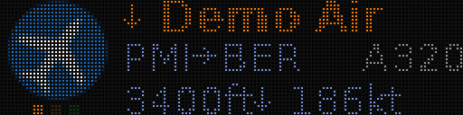
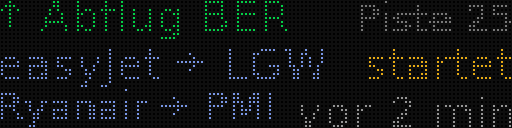
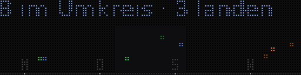
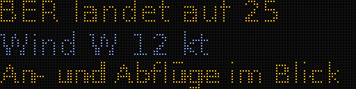
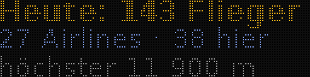
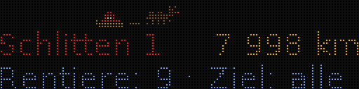
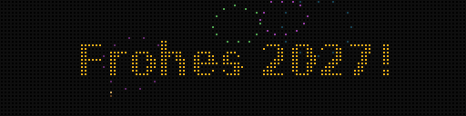

# Screens and priorities

What the panel shows, in fixed tiers: a tier only gets its turn when no higher tier has anything to show. Flights (tier 1) are drawn by `render.py`, everything else are idle cards (`server/flightpanel/cards/`, selection in `idle.py`). The texts on the panel are in German.

**Selection:** within a tier, cards change every `IDLE_SECONDS` (12 s, 30 s in calm mode): urgent cards first (several urgent ones take turns), otherwise weighted random, avoiding the most recently shown. The clock runs along in every idle tier, about a third of the time (`IDLE_CLOCK_SHARE`). Urgent are: a new airline (2 min), a plane arriving in the view field in under 3 minutes, a rare type or a VIP visit (2 min), the ISS passing overhead right now.

**Turning cards off:** any card with `panels set home CARD_<ID>=0` ([configuration.md](configuration.md#per-panel-settings)), including clock and emergency. If no enabled card has anything to show, the panel stays dark.

**New Year:** at midnight the panel belongs to the fireworks for five minutes, ahead of flights and even during quiet hours (then at evening brightness); only an emergency comes first. For the rest of January 1 the fireworks are one card among many in tier 3. Not on New Year's Eve.

**Calm mode (`CALM=1`):** nothing blinks except an emergency, info pages 10 s, each flight at least 20 s, idle cards 30 s, only arrival time and altitude/speed in the info line. Individually: `PAGE_SECONDS`, `FLIGHT_SECONDS`, `INFO_PAGES`, `BLINK`, `IDLE_SECONDS`.

`/idle` lists all cards with their tier, whether they currently have something to say and which one is showing; `/frame.png?card=<id>` shows one card, with demo data if it has nothing to say right now.

## Flights

The server ranks all aircraft in range on every fetch:

1. **View field first.** Aircraft that will enter it before the next fetch count too (extrapolated from speed, track and vertical rate), otherwise approaches would be past before they appear on the panel.
2. **Arrivals and departures here before overflights, airlines first in each group.** If more are in view than `MAX_FLIGHTS` allows: airlines landing or departing here; private aircraft doing so; airline overflights; private overflights. Scheduled, charter and cargo flights count as airlines; private aircraft include business jets, helicopters, police and military (`"airline": false` in `data/airlines.json`). Landing and departing are recognised from the landing sequence, the route or, for airlines without a route, altitude and vertical rate. `SHOW_OTHER=0` hides private aircraft.
3. **Landing sequence, then shortest line of sight.** The next to land comes first. The server estimates the sequence from the remaining distance to the runway, along the approach pattern; it detects the landing direction from traffic near the airport.

Up to `MAX_FLIGHTS` flights take turns, each with all its info pages, for at least `FLIGHT_SECONDS`.

**Layouts** (`LAYOUT`): **C** logo on the left (32 × 32) and three lines on the right; **A** no logo, full width; **B** two flights, one line each. Without a logo, C shows a grey symbol in its place so text and sky dots don't jump: a plane for airlines, a light aircraft or helicopter for private aircraft.

- Line 1: arrow (↓ landing, ↑ departure, → overflight) and airline. The arrow shows the status in colour (landing amber, departure green, overflight blue); the airline name is neutral grey so it stands apart from the logo.
- Line 2: route, otherwise what the flight is (air rescue, police, light aircraft: from `airlines.json`, ADS-B category or registration), otherwise `?→BER` or `BER→?`; the aircraft type on the right.
- Line 3 rotates (`INFO_PAGES`): minutes to landing, altitude and speed, distance and track, callsign.

**Sky dots:** when at least two of the shown aircraft are in the view field, a row of dots appears under the (then 28 × 28) logo, one per flight in reading order: the leftmost lands first. The dot of the flight on screen is lit. Rare types and VIP visits get a gold dot. The panel cycles through the flights in this order, and each keeps its full time even if one before it lands or leaves the view field.

**Principles:** nothing is shown twice (the callsign drops out of the rotation if it's already on top). Text is never shortened in a way that changes its meaning: first a smaller font, then a shorter wording. Text at the edge sits on the first or last pixel column. Private aircraft are named by registration, rescue helicopters by their call name (e.g. "Christoph 31"); owner names never appear. An honest `?` beats a wrong origin.

## Gallery

Rendered with demo data (`tools/screenshots.py`), in the same LED look as the browser preview. "Demo Air" and its logo are made up.

| | |
|---|---|
|  Flight, layout C: minutes to landing, sky dots in landing order |  next info page: altitude, descending, speed |
|  a departure without logo in the same rotation: placeholder, the dots stay in place |  private aircraft in the rotation: helicopter symbol instead of a logo |
|  `departures` |  `arrivals` |
|  `next`: time until it enters the view field, and from which side |  `radar`: view field as a band in the middle |
|  `runway` |  `weather` |
|  `iss` |  `scoreboard` |
|  `pokedex` |  `clock` |
|  `santa` |  `fireworks`: New Year, at midnight ahead of everything else |

## All cards

| Tier | Card | Shows | When |
|---|---|---|---|
| **0 Emergency** | `alert` | squawk and meaning, callsign, type, where, whether in view | squawk 7700/7600/7500 within the scan radius; ahead of everything, flights included |
| **1 In view** | flight (layout C/A/B) | airline or private aircraft (grey symbol without logo), route, type; rotating minutes to landing, altitude and speed, distance and track, callsign; sky dots in landing order | in the view field or entering it before the next fetch. If `MAX_FLIGHTS` isn't enough: arrivals and departures here before overflights, airlines first |
| **2 Airport traffic** | `departures` | "↑ Abflug BER", runway; up to two flights with destination and taxiing / taking off / "2 min ago" | on the ground with a route from here (taxiing from 5 kt, taking off from 40 kt), or airborne below 3000 m, climbing, moving away, departed at most ~5 min ago |
| | `arrivals` | "↓ Landung BER", runway; the next two with origin and minutes | in the landing sequence, landing within 15 minutes |
| | `next` | next plane: "visible in ~3 min" (time until it enters the view field, not until landing), side of the window (← →) | enters the view field in 15 s to 10 min, urgent below 3 min; arrivals computed along the final approach |
| | `runway_change` | runway change and what it means for the window | up to 1 h after a change (confirmed by three fetches in a row) |
| **3 Quiet** | `radar` | all-round view, view field as a band, dots by direction and elevation; the nearest blinks | aircraft in range |
| | `runway` | "BER landet auf 25" (landing on 25), wind, whether arrivals or departures pass the view field | landing direction stable for 30 min, confirmed in the last 2 h, no tailwind according to METAR |
| | `weather` | why the sky is empty: thunderstorm, fog, low clouds, snow; how many fly above | METAR explains it: thunderstorm, snow; fog (visibility under 2 km) when someone is flying; clouds below 1500 m when someone is above them |
| | `curfew` | night flight ban until … | `CURFEW_HOURS` (BER 0:00 to 5:00), if `QUIET_HOURS` doesn't switch the panel off then |
| | `scoreboard` | daily statistics: aircraft around, how many through the view field; at the bottom, in step with the info pages, airlines and the highest | from 10 aircraft a day |
| | `pokedex` | collection album: brands seen from `airlines.json` (without small operators marked `"album": false`), plus exotics | from the first airline |
| | `new` | "NEU!" (new) with logo | airline seen for the first time, not in the first 6 h after the very first start |
| | `rare` | far away but rare (e.g. an A380 70 km southeast), or a VIP visit | type from `data/rare.json`, or government/military (`airlines.json` label, plus callsigns from `rare.json`) within the scan radius |
| | `quiet` | lull and daily record | from 10 min without an aircraft in the view field; the timer restarts after a fetch gap |
| | `iss` | ISS pass: direction, elevation, whether through the window | visible pass within 30 min, or happening now (urgent) |
| | `sunset`, `sunrise` | time; "Gegenlicht" (backlight) when the sun is in the view field | 2 h before sunset, 90 min before sunrise |
| | `santa` | sleigh 1 on approach | December 24 from 15:00 |
| | `fireworks` | fireworks and a New Year greeting with the current year | January 1; at midnight five minutes ahead of everything except an emergency, even in quiet hours |
| | `clock` | time and date | always |
| **4 Nothing going on** | `plane`, `pigeon` | animations: a plane crossing the screen, a pigeon on the balcony | only when nothing at all is going on (no departure or landing at the airport for 15 minutes and none landing in the next 10), then mixed with tier 3 |

Seasonal cards are in tier 3: on their days they appear even when there's traffic, but after flights and airport traffic. Radar is in tier 3 because it almost always has something to show and would otherwise crowd out the rest.
